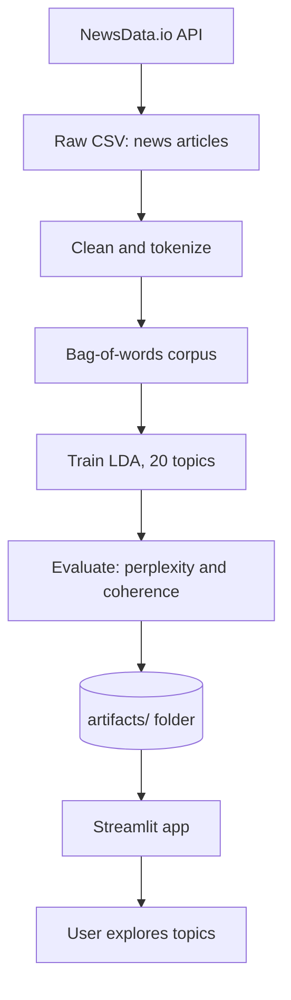

# End-to-End Topic Modeling of News Articles

An unsupervised NLP project that automatically discovers hidden topics in thousands of scraped news articles using **Latent Dirichlet Allocation (LDA)**, and lets you explore them through an interactive **Streamlit** web app.

No article is labeled by hand. The model only sees raw text and groups words and documents by how often they co-occur.

## Results at a glance

| Articles modeled | Topics discovered | Log perplexity | Coherence (c_v) |
|:---:|:---:|:---:|:---:|
| 8,914 | 20 | -13.11 | 0.557 |

Coherence is the more trustworthy metric here. It measures whether the top words of a topic really appear together in documents. A score of 0.557 indicates a solidly coherent set of topics.

## How it works

The project separates a slow, offline **training** job from a fast **serving** app, as real ML systems do.



1. **Collect and clean** (`prepare_artifacts.py`): normalize raw text so the model sees meaningful words.
2. **Model** (`prepare_artifacts.py`): train LDA, score it, and save everything to `artifacts/`.
3. **Explore** (`app.py`): the Streamlit app only loads the saved artifacts. It never retrains.

### Why split training and serving?

- **Cost:** training takes minutes, and the app starts in about 1 to 2 seconds.
- **Dependencies:** the app does not need NLTK corpora or the raw dataset.
- **Reliability:** a slow or broken training step can't take the app down.
- **Reusability:** the same artifacts could be reused by an API or notebook later.

## Project structure

```
.
├── Topic_Modelling.ipynb               # Original exploratory notebook
├── prepare_artifacts.py                # Training script: clean, train, score, save
├── app.py                              # Streamlit app (serving layer)
├── run_app.bat                         # One-click launcher (Windows)
├── requirements.txt                    # Dependencies
├── Topic_Modeling_Project_Explained.pdf  # Detailed code walkthrough
├── artifacts/                          # Output of training, read by the app
└── final_data_topic_modelling.csv      # Raw data (not in repo, see Dataset)
```

## Dataset

The input is `final_data_topic_modelling.csv`, with one news article per row. The data was **collected from the [NewsData.io](https://newsdata.io) API**, which returns news articles as structured JSON. The responses were gathered and saved into a single CSV file, which is the starting point of this pipeline.

Only two columns are used:

- `Title`: the headline, used only for display.
- `Content`: the article body, which the model learns from.

The file is about 70 MB, so it is **not included in this repository**. You can either:

- **Download the dataset** from **Link** and place it in the project root, or
- **Collect your own data** from the NewsData.io API using a free API key from [newsdata.io](https://newsdata.io), and save it as `final_data_topic_modelling.csv` with `Title` and `Content` columns.

Check NewsData.io's terms of service before redistributing the collected articles.

The CSV is read with `latin1` encoding. A small helper (`fix_mojibake`) repairs garbled characters in titles, such as `’`, for display.

## Pipeline details

### 1. Text cleaning

Each article goes through `clean_to_tokens()`:

| Step | Purpose |
|---|---|
| Expand contractions (`don't` to `do not`) | Keep word forms consistent |
| Lowercase | Avoid duplicate vocabulary entries |
| Remove punctuation | Punctuation carries no topical signal |
| Tokenize (NLTK) | LDA works on discrete tokens |
| Drop tokens containing digits | Dates, scores, and prices are noise |
| Drop stopwords and tokens of 2 characters or fewer | Remove filler words |
| Lemmatize (WordNet) | Merge inflections (`running`, `ran` to `run`) |

Articles with fewer than 6 usable tokens are dropped. Of 8,933 articles, 8,914 remain.

### 2. Bag-of-words (Gensim)

- `corpora.Dictionary` maps each word to an integer ID.
- `filter_extremes(no_below=5, no_above=0.5)` removes words found in fewer than 5 articles or more than half of all articles.
- `doc2bow` turns each article into `(word_id, count)` pairs.

### 3. LDA training

LDA assumes every document is a **mixture of topics**, and every topic is a **distribution over words**.

```python
lda_model = gensim.models.LdaModel(
    corpus=corpus,
    id2word=id2word,
    num_topics=20,
    random_state=100,
    update_every=1,
    chunksize=100,
    passes=10,
    alpha="auto",
    per_word_topics=True,
)
```

| Parameter | Value | Meaning |
|---|---|---|
| `num_topics` | 20 | Number of latent topics |
| `passes` | 10 | Full passes over the corpus |
| `chunksize` | 100 | Documents per mini-batch |
| `alpha` | `"auto"` | Learned document-topic prior |
| `random_state` | 100 | Reproducible results |

### 4. Evaluation

- **Perplexity** (`log_perplexity`): how well the model predicts the corpus. Closer to zero means a better fit, but it correlates weakly with human judgment.
- **Coherence (c_v)**: whether the top words in a topic co-occur in real documents. Typical scores range from about 0.3 (weak) to the low 0.6s (strong).

### 5. Post-processing

- **Dominant topic** for each article (the topic with the highest probability).
- **Top 15 words** per topic, with weights.
- **Short labels** from the top 3 words, for example `israel / hamas / gaza`.
- **8 representative headlines** per topic, ranked by match strength.
- **pyLDAvis** interactive topic map.

## The `artifacts/` folder

Everything `app.py` displays comes from these files, which `prepare_artifacts.py` regenerates.

| File | Type | Used for |
|---|---|---|
| `lda_model.gensim` (+ `.expElogbeta.npy`, `.state`, `.id2word`) | Gensim model files | The trained LDA model |
| `dictionary.gensim` | Gensim Dictionary | Standalone word to ID vocabulary |
| `doc_topics.pkl` | Pandas DataFrame | Per-article dominant topic and probability |
| `topic_words.json` | JSON | Top words and weights per topic |
| `topic_labels.json` | JSON | Short 3-word label per topic |
| `representative_docs.json` | JSON | Most representative headlines per topic |
| `metrics.json` | JSON | Perplexity, coherence, document and topic counts |
| `pyldavis.html` | HTML | Self-contained interactive topic map |

## The Streamlit app

- **Overview:** bar chart of articles per topic and key metrics.
- **Topic Explorer:** choose a topic to see its top-word chart, its most representative headlines, and its article count.
- **Topic Map:** the interactive pyLDAvis visualization. Bubble size shows topic prevalence, and bubble distance shows vocabulary similarity.

The loaders use `@st.cache_resource` (for the Gensim model) and `@st.cache_data` (for JSON and DataFrames) so nothing reloads on every click.

## Getting started

### 1. Clone and set up the environment

```bash
git clone https://github.com/sampik123/End-to-End-Topic-Modeling.git
cd End-to-End-Topic-Modeling

python -m venv venv
venv\Scripts\activate          # Windows
pip install -r requirements.txt
```

### 2. Add the dataset

Place `final_data_topic_modelling.csv` in the project root.

### 3. Train the model (only needed when the data or pipeline changes)

```bash
python prepare_artifacts.py
```

This downloads the NLTK resources on the first run and writes everything to `artifacts/`.

### 4. Launch the app

```bash
streamlit run app.py
```

On Windows you can also double-click `run_app.bat`.

## Tech stack

Python, Gensim, NLTK, pandas, NumPy, SciPy, Streamlit, Plotly, pyLDAvis, contractions. Data source: NewsData.io API.

## Possible next steps

- **BERTopic:** try embedding-based topic modeling, which often gives cleaner topics on noisy text.
- **Choose the topic count:** sweep `num_topics` against coherence instead of fixing it at 20.
- **Temporal trends:** plot topic share over time if publish dates can be recovered.
- **LLM-generated labels:** replace the 3-word labels with readable topic names.
- **Monitoring:** track which topics users open and use that as a retraining signal.

## Documentation

For a full code-level walkthrough of every script, function, and artifact, see [`Topic_Modeling_Project_Explained.pdf`](Topic_Modeling_Project_Explained.pdf).
